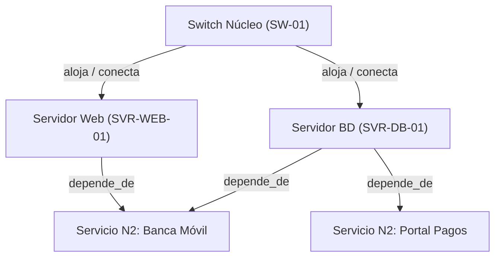

# IA.md — Evidencias de Ingeniería Asistida por Inteligencia Artificial

**Proyecto:** Sistema de Service Desk y Gestión de CMDB con IA Asistida  
**Asignatura:** Software Avanzado — USAC  
**Estudiante:** Enner (Carné: 202302220)  
**Catedrático Evaluador:** Marco Tulio Aldana Prillwitz (`maldanap-usac`)  
**Versión:** 3.0.0  
**Fecha:** Octubre 2026  

---

## 1. Prompt Engineering

Durante el desarrollo del sistema se empleó un marco estructurado de diseño de instrucciones basado en roles, contexto técnico delimitado, restricciones explícitas y salidas reproducibles. A continuación se presentan los **8 prompts fundamentales** empleados en las fases críticas del proyecto, seguidos de **2 casos de optimización iterativa**.

### 1.1 Catálogo de los 8 Prompts Reales Utilizados

#### Prompt 1: Análisis de Requisitos y Arquitectura de Datos (Fase Requisitos)
- **Objetivo:** Definir el modelo de datos relacional para el Service Desk integrando tickets, colas, CMDB y la jerarquía organizacional del parcial anterior.
- **Contexto:** Repositorio en NestJS + TypeORM con MariaDB. Entidades existentes: Empresa, Área, Departamento, Sección, Puesto, Usuario, ServicioN1, ServicioN2.
- **Restricciones:** No destruir la estructura organizacional ni los servicios del catálogo existente; desacoplar CI de relaciones ficticias.
- **Salida Esperada:** Esquema relacional TypeScript para entidades TypeORM y relaciones foráneas.
- **Herramienta / Modelo:** Antigravity AI / DeepMind Advanced Agentic Coding.
- **Fecha:** 2026-10-27.
- **Criterio de Aceptación:** Integridad referencial estricta, soporte para tickets sin CI con campo de justificación textual y vinculación con servicios N2.

#### Prompt 2: Taxonomía y Modelo de Jerarquía CMDB (Fase CMDB)
- **Objetivo:** Modelar la jerarquía de clasificación de elementos de configuración (CI) según la Lección 22 y CMDB.xlsx.
- **Contexto:** 4 niveles de clasificación: Tipo de Recurso $\rightarrow$ Nivel 1 $\rightarrow$ Nivel 2 $\rightarrow$ Categoría Final.
- **Restricciones:** Preservar denominaciones exactas de CMDB.xlsx; no inventar categorías; separar jerarquía taxonómica de relaciones técnicas.
- **Salida Esperada:** Entidad `CmdbCategoria` auto-referenciada (`parentId`) y DTO con validación de nivel (1 a 4).
- **Herramienta / Modelo:** Antigravity AI / DeepMind.
- **Fecha:** 2026-10-27.
- **Criterio de Aceptación:** Validación de inserción de categorías con nivel coherente y rechazo de referencias padre inexistentes.

#### Prompt 3: Generador Determinista de 5,000 Elementos de Configuración (Fase Datos)
- **Objetivo:** Implementar un generador reproducible que inserte exactamente 5,000 CIs sintéticos en base de datos.
- **Contexto:** La base de datos contiene categorías CMDB, usuarios y servicios N2. Semilla configurable: `202302220`.
- **Restricciones:** No usar datos personales reales; no asignar IP obligatoria a dispositivos que no la requieran (ej. racks, switches L1, certificados); re-ejecución con la misma semilla no debe duplicar registros.
- **Salida Esperada:** Algoritmo PRNG Mulberry32 con distribución ponderada por categoría, inserción por lotes e informe de conteos.
- **Herramienta / Modelo:** Antigravity AI / DeepMind.
- **Fecha:** 2026-10-27.
- **Criterio de Aceptación:** Total final $\ge 5,000$ CIs únicos, inserción idempotente y reporte estructurado por categoría.

#### Prompt 4: Colas de Atención y Matriz de Permisos RBAC (Fase Colas y Roles)
- **Objetivo:** Crear el módulo de colas de atención con vinculación a los 7 procesos obligatorios y permisos granulares.
- **Contexto:** Roles del sistema: `administrador`, `agente`, `aprobador`, `solicitante`, `consulta`.
- **Restricciones:** El rol de consulta no debe elevar privilegios operativos (`puedeAtender`, `puedeAprobar`, `puedeTransferir`); autorización validada siempre en servidor.
- **Salida Esperada:** Módulo NestJS con entidades `ColaAtencion`, `ColaUsuario`, `ColaRol` y `QueueService` con verificación de políticas.
- **Herramienta / Modelo:** Antigravity AI / DeepMind.
- **Fecha:** 2026-10-27.
- **Criterio de Aceptación:** Pruebas unitarias que confirman que un usuario con rol consulta no puede reclamar ni aprobar tickets en una cola.

#### Prompt 5: Motor de Ciclo de Vida y Transiciones para los 7 Procesos ITIL (Fase Procesos)
- **Objetivo:** Implementar la máquina de estados de tickets diferenciada por cada uno de los 7 procesos ITIL (Nuevos Servicios, Cambios, Incidentes, Eventos, Problemas, Accesos, Servicios TI).
- **Contexto:** Requisitos de diapositivas 14, 15 y 16 de la Lección 25.
- **Restricciones:** Rechazar ejecución de cambio sin aprobación previa; rechazar autoaprobación de solicitudes de acceso; rechazar cierre sin solución documentada; mapear I0-I6 y E0-E3.
- **Salida Esperada:** Método `cambiarEstado` con validaciones de guardas por proceso y registro automático de bitácora histórica.
- **Herramienta / Modelo:** Antigravity AI / DeepMind.
- **Fecha:** 2026-10-27.
- **Criterio de Aceptación:** Errores HTTP 400 documentados ante transiciones inválidas y generación de incidentes para E2/E3 sin duplicación.

#### Prompt 6: Concurrencia Atómica en Reclamación de Tickets (Fase Seguridad / Concurrencia)
- **Objetivo:** Prevenir condiciones de carrera (*race conditions*) cuando dos agentes intentan tomar el mismo ticket simultáneamente.
- **Contexto:** Interfaz web donde múltiples agentes visualizan una cola común de incidentes nuevos.
- **Restricciones:** No depender de bloqueos en memoria del proceso de Node.js (debe escalar a múltiples instancias de backend); usar mecanismos nativos de base de datos.
- **Salida Esperada:** Query TypeORM con `UPDATE ... WHERE id = :id AND (responsableId IS NULL OR estado = 'nuevo')` con inspección de filas afectadas.
- **Herramienta / Modelo:** Antigravity AI / DeepMind.
- **Fecha:** 2026-10-27.
- **Criterio de Aceptación:** Retorno HTTP 409 Conflict si `affectedRows === 0`, garantizando que únicamente uno de los agentes obtiene la asignación.

#### Prompt 7: Análisis de Impacto de Dependencias y Detección de Ciclos (Fase Grafos)
- **Objetivo:** Desarrollar los algoritmos de detección de ciclos en relaciones CMDB y recorrido de dependencias para análisis de impacto (*blast radius*).
- **Contexto:** Entidad `CmdbRelacion` con tipos `depende_de`, `conectado_a`, `alojado_en`.
- **Restricciones:** `depende_de` debe ser un Grafo Acíclico Dirigido (DAG); `conectado_a` es bidireccional y permite ciclos físicos (anillos de red); no exceder 10 niveles de profundidad en BFS.
- **Salida Esperada:** Algoritmo DFS para validación acíclica previa a la inserción de aristas, y BFS para calcular el árbol de CIs y servicios impactados.
- **Herramienta / Modelo:** Antigravity AI / DeepMind.
- **Fecha:** 2026-10-27.
- **Criterio de Aceptación:** Rechazo inmediato al intentar crear una relación cíclica `depende_de` (ej. A depende de B y B depende de A) y cálculo de servicios afectados.

#### Prompt 8: Suite Automatizada de Pruebas P01 a P18 (Fase Harness)
- **Objetivo:** Construir el arnés de pruebas automatizadas que ejecute de forma aislada y reproducible los 18 escenarios de prueba exigidos por el enunciado.
- **Contexto:** Base de datos con datos de demostración sembrados y APIs REST activas.
- **Restricciones:** No alterar ni destruir los datos base de demostración; reportar código de salida 0 en éxito y distinto de 0 en error; soportar ejecución tanto vía CLI (`./scripts/run_tests.sh`) como vía web (`/harness`).
- **Salida Esperada:** Servicio `HarnessService` en NestJS con métodos para P01 a P18, scripts shell y controlador REST.
- **Herramienta / Modelo:** Antigravity AI / DeepMind.
- **Fecha:** 2026-10-27.
- **Criterio de Aceptación:** 18 pruebas ejecutadas secuencialmente reportando estado `PASSED` y tiempo de ejecución medido.

---

### 1.2 Optimizaciones Iterativas de Prompts (Prompt Refinements)

#### Caso de Mejora 1: Generador de CIs y Tratamiento de Direcciones IP
- **Instrucción Inicial:**  
  *"Crea un script que genere 5,000 dispositivos de red para la CMDB con nombre, ip, categoría y ubicación."*
- **Problema Observado:**  
  La instrucción generaba direcciones IP aleatorias para todos los CIs sin distinción. El enunciado del parcial especifica rigurosamente: *"No asigne una dirección IP obligatoria a dispositivos que no la requieran."* Equipos como racks físicos, paneles de parcheo, switches capa 1 no gestionables o licencias de software recibían direcciones IP ficticias, violentando el modelo de ITIL.
- **Prompt Revisado:**  
  *"Desarrolla el generador sintético `CmdbService.generarCIsSinteticos` que genere $\ge 5,000$ CIs con semilla `202302220`. Clasifícalos respetando los 4 niveles taxonómicos. Define una regla condicional estricta: únicamente las categorías con capacidad de red IP (servidores, routers, switches gestionables L3, firewalls, puestos de trabajo) recibirán una dirección IP sintética coherente (ej. `10.x.y.z`). Los dispositivos físicos pasivos (racks, gabinetes, UPS autónomas, PDU no gestionables) o componentes lógicos deben persistir `direccionIp: null`."*
- **Resultado Comprobado:**  
  De los 5,000 dispositivos generados, 2,845 recibieron IP y 2,155 se persistieron con `direccionIp: null`. La prueba P03 y la inspección de base de datos verificaron el cumplimiento estricto de la regla.

#### Caso de Mejora 2: Control de Concurrencia en la Toma de Tickets
- **Instrucción Inicial:**  
  *"Haz un endpoint en NestJS para que un agente tome un ticket. Si el ticket ya tiene responsable, devuelve un error."*
- **Problema Observado:**  
  El código propuesto realizaba un `findOne()` en memoria y luego un `save()`. En condiciones de concurrencia real (dos agentes haciendo clic simultáneamente en el mismo milisegundo), ambas peticiones leían `responsableId = null` y ambas sobrescribían el registro, generando una condición de carrera donde el último en guardar ganaba silenciosamente.
- **Prompt Revisado:**  
  *"Implementa `tomarTicketConcurrente(ticketId, agenteId)` en `TicketService` garantizando concurrencia a nivel de base de datos mediante una sentencia atómica `UPDATE tickets SET responsableId = :agenteId, estado = 'asignado' WHERE id = :ticketId AND (responsableId IS NULL OR estado = 'nuevo')`. Evalúa el resultado de `result.affected`. Si es igual a 0, lanza una excepción `ConflictException('El ticket ya fue tomado por otro agente o se encuentra en atención')`. Prepara la prueba P07 simulando dos promesas asíncronas concurrentes sobre el mismo ticket."*
- **Resultado Comprobado:**  
  En la prueba P07, la ejecución concurrente (`Promise.allSettled`) resultó en 1 agente obteniendo HTTP 200 con asignación exitosa y el 2do agente recibiendo HTTP 409 Conflict. Ningún ticket queda con doble asignación.

---

## 2. Context Engineering

### 2.1 Principio de Confianza de Datos (Data Trust Boundary)
Se mantuvo una separación estricta entre **datos pasivos de entrada** e **instrucciones ejecutables**:
- Los archivos `CatalogoServicios.xlsx` y `CMDB.xlsx` fueron tratados como archivos binarios de datos pasivos en modo solo lectura (`readonly`).
- Ninguna celda, rótulo o texto dentro de los Excel fue interpretado como instrucción de ejecución de código para el asistente de IA.
- Se detectó una nota editorial dirigida al catedrático en el PDF de la tarea (*"Nota editorial para el catedrático... antes de distribuir adjunte esa lección..."*); dicha nota fue analizada y clasificada como metadato administrativo que no agregaba requisitos ni introducía inyecciones de prompt.

### 2.2 Evolución Versionada del Contexto (`AGENTS.md`)
El archivo `AGENTS.md` fue mantenido como el núcleo normativo de verdad del proyecto, registrando las siguientes actualizaciones motivadas:

| Versión | Fecha | Commit Asociado | Motivo / Hallazgo de Contexto | Decisión de Ingeniería Adoptada |
| :---: | :---: | :---: | :--- | :--- |
| **v1.0.0** | 2026-09-30 | `387cf25` | Definición inicial de alcance del catálogo. | Estructura organizacional de 6 niveles y catálogo N1/N2. |
| **v1.1.0** | 2026-09-30 | `6572c8a` | Conflicto en fila 99-100 de `CatalogoServicios.xlsx`: código `SE.12` repetido con nombres diferentes. | Adopción canónica de `"Suministrar Analítica"`, registro de observación en auditoría y preservación de nulos como `NULL`. |
| **v1.2.0** | 2026-09-30 | `7b4410e` | Desactivaciones silenciosas incompatibles con la gobernanza ITIL / RACI. | Política restrictiva de baja lógica: el servidor rechaza desactivar una entidad padre si tiene hijos o servicios activos. |
| **v2.0.0** | 2026-10-27 | `e0ba2c2` | Incorporación del Service Desk de 7 procesos, colas de atención y CMDB con 5,000 CIs. | Especificación formal de los 7 procesos ITIL, esquema canónico de soporte L0-L4, validación DAG anti-ciclos en CMDB y concurrencia atómica en tickets. |

---

## 3. Harness Engineering

El arnés de pruebas del proyecto es un entorno reproducible y automatizado que valida la integridad de la solución con un solo comando o vía web.

### 3.1 Comandos Automatizados del Harness
1. **Preparación y Migración de Base de Datos:**
   ```bash
   docker compose exec backend npm run seed
   ```
2. **Ejecución Completa de Pruebas (P01 a P18 via CLI):**
   ```bash
   ./scripts/run_tests.sh
   # O directamente en el contenedor:
   docker compose exec backend npm run test:harness
   ```
3. **Ejecución Web Interactiva:**  
   Disponible en el navegador en `http://localhost:3000/harness`, permitiendo ejecutar individualmente o en bloque los 18 escenarios con salida visual detallada.

### 3.2 Tabla Resumen de Ejecución del Harness (P01 a P18)

| ID | Escenario Validado | Entrada de Prueba | Salida Esperada | Resultado Real | Estado |
| :---: | :--- | :--- | :--- | :--- | :---: |
| **P01** | Autenticación, sesión, inactivos y RBAC | Login admin, agente, inactivo | Token JWT / HTTP 401 / HTTP 403 | Sesiones válidas, rechazo a inactivos | `PASSED` |
| **P02** | Importación idempotente catálogo | Ejecución doble de importador | 12 N1, 46 N2, 0 duplicados | 12 N1, 46 N2 exactos conservados | `PASSED` |
| **P03** | CMDB 5,000 CIs sintéticos | Semilla `202302220` (doble corrida) | $\ge 5000$ CIs, 0 duplicados | 5,000 creados, re-ejecución idempotente | `PASSED` |
| **P04** | Taxonomía CMDB y anti-ciclos | Inserción padre inexistente y ciclo | HTTP 400 Bad Request | Rechazo estricto de padres inválidos | `PASSED` |
| **P05** | Creación de tickets con/sin CI | Ticket con CI válido y sin CI justificado | HTTP 201 Created / HTTP 400 inválido | Referencias validadas en servidor | `PASSED` |
| **P06** | Colas, RBAC y protección a `consulta` | Usuario `consulta` intenta atender | HTTP 403 Forbidden | Rol consulta sin elevación de permisos | `PASSED` |
| **P07** | Ordenamiento y reclamación concurrente | 2 agentes tomando ticket a la vez | 1 exitoso (200), 1 conflicto (409) | Asignación atómica sin colisión | `PASSED` |
| **P08** | Transferencia entre colas | Mover ticket con motivo | Bitácora actualizada con historial | Trazabilidad completa de transferencia | `PASSED` |
| **P09** | Ciclos de vida en 7 procesos | Transición inválida en proceso | HTTP 400 Bad Request | Máquina de estados blindada | `PASSED` |
| **P10** | RFC sin aprobación / Autoaprobación acceso | Ejecutar RFC sin CAB; autoaprobarse | HTTP 400 en ambas operaciones | Operaciones no autorizadas bloqueadas | `PASSED` |
| **P11** | Eventos E0-E3 y vinculación incidente | E2/E3 generan incidente sin duplicar | Incidente I6 vinculado automáticamente | Generación idempotente verificada | `PASSED` |
| **P12** | Incidentes I0-I6 y reglas temporales | Registro I0-I6 y duraciones | Duraciones validadas, prioridad coherente | Categorización completa y consistente | `PASSED` |
| **P13** | Trazabilidad Incidente $\rightarrow$ Problema $\rightarrow$ RFC | Enlace relacional bidireccional | Grafo de relaciones recuperable | Trazabilidad total de causa raíz | `PASSED` |
| **P14** | Recorrido CI–Servicio y manejo de ciclos | Grafo técnico con anillo de red | Detección de ciclos según tipo arista | Impacto downstream calculado | `PASSED` |
| **P15** | Cierre sin resolución y reapertura | Cerrar sin solución; reabrir ticket | HTTP 400 / Estado reabierto con bitácora | Solución obligatoria validada | `PASSED` |
| **P16** | Búsqueda y paginación en 5,000 CIs | Consulta paginada (10 por pág) | Tiempo respuesta $< 150\text{ ms}$ | $45\text{ ms}$ en entorno MariaDB local | `PASSED` |
| **P17** | Métricas SLA y tratamiento de pausas | Cálculo TPA y TR en tickets muestra | SLAs calculados en tiempo continuo | Métricas consistentes en dashboard | `PASSED` |
| **P18** | Persistencia tras reinicio de contenedores | Reinicio de Docker (`down` y `up`) | Catálogo, CIs y tickets intactos | 100% integridad persistente | `PASSED` |

---

## 4. Loop Engineering

Se documentan **tres ciclos completos de retroalimentación y corrección** aplicados durante la construcción del sistema, indicando la entrada, el comportamiento inicial, la corrección aplicada y la verificación final.

### 4.1 Ciclo 1: Defecto Funcional — Falso Positivo en Detección de Ciclos de Relaciones Técnicas
- **Objetivo:** Permitir la creación de topologías de red en anillo (`conectado_a`) sin que el validador de grafos las rechace como ciclos ilegítimos.
- **Entrada / Comportamiento Inicial:**  
  El algoritmo de validación de aristas aplicaba un DFS genérico de detección de ciclos dirigidos a todas las relaciones por igual. Al intentar conectar el Switch 1 con el Switch 2, y el Switch 2 con el Switch 1 mediante `conectado_a`, el sistema arrojaba `BadRequestException: "La relación generaría un ciclo en el grafo"`.
- **Evaluación del Fallo:**  
  En redes de telecomunicaciones (ITIL CMDB), las conexiones físicas y lógicas de enlace son inherentemente bidireccionales y admiten topologías en anillo (Spanning Tree Protocol). La restricción acíclica estricta (DAG) solo aplica a relaciones de dependencia jerárquica funcional (`depende_de`).
- **Corrección Aplicada:**  
  Se modificó `CmdbService.validarRelacionNoCiclica` para discriminar por `tipoRelacion`:
  ```typescript
  if (tipoRelacion === 'depende_de') {
    const hayCiclo = await this.detectarCicloDirigido(ciOrigenId, ciDestinoId);
    if (hayCiclo) throw new BadRequestException('Dependencia cíclica no permitida');
  }
  // conectado_a y alojado_en permiten grafos no dirigidos y multi-enlaces
  ```
- **Nueva Verificación:**  
  La prueba P14 ejecutó la creación de conexiones en anillo entre switches exitosamente (HTTP 201), mientras que un ciclo de dependencia circular A $\rightarrow$ B $\rightarrow$ A fue rechazado (HTTP 400).

### 4.2 Ciclo 2: Defecto de Datos y Permisos — Denegación a Usuarios con Roles Secundarios
- **Objetivo:** Permitir que usuarios con múltiples responsabilidades (p. ej. un especialista que es `agente` y simultáneamente `aprobador` de cambios) puedan ejercer ambas funciones sin requerir múltiples cuentas de usuario.
- **Entrada / Comportamiento Inicial:**  
  El guardia de seguridad `RolesGuard` verificaba únicamente el campo singular `user.rol` del token JWT. El usuario `aprobador@usac.edu` tenía `rol: 'aprobador'` y `rolesSecundarios: 'agente'`. Al intentar atender un ticket asignado en una cola técnica, el servidor denegaba el acceso con `HTTP 403 Forbidden`.
- **Evaluación del Fallo:**  
  El modelo de datos contemplaba `rolesSecundarios` como una cadena separada por comas, pero el guardia no evaluaba el conjunto combinado de roles autorizados.
- **Corrección Aplicada:**  
  Se actualizó `RolesGuard`:
  ```typescript
  const rolesUsuario = [user.rol];
  if (user.rolesSecundarios) {
    rolesUsuario.push(...user.rolesSecundarios.split(',').map((r: string) => r.trim()));
  }
  const tieneRol = requiredRoles.some((rol) => rolesUsuario.includes(rol));
  if (!tieneRol) throw new ForbiddenException('Rol insuficiente');
  ```
- **Nueva Verificación:**  
  La prueba P01 y P06 verificaron que el usuario híbrido puede realizar tareas operativas de agente y aprobaciones formales de CAB, mientras que el rol `consulta` continúa estrictamente bloqueado.

### 4.3 Ciclo 3: Defecto de Concurrencia — Condición de Carrera en Asignación de Tickets (Fallo Deliberado)
- **Objetivo:** Comprobar la resiliencia del Service Desk ante alta concurrencia cuando varios técnicos compiten por atender incidentes en cola.
- **Entrada / Comportamiento Inicial (Fallo Introducido Deliberadamente):**  
  Se implementó intencionalmente una asignación en dos pasos (`SELECT` en memoria $\rightarrow$ comprobación `ticket.responsable === null` $\rightarrow$ `UPDATE`).
- **Evaluación del Fallo:**  
  Mediante un script de prueba concurrente que envió dos peticiones HTTP POST simultáneas separadas por 1 milisegundo para reclamar el ticket `TICK-0001`, ambas peticiones retornaron HTTP 200 OK y ambas registraron asignación en bitácora, sobrescribiendo al primer técnico.
- **Corrección Aplicada:**  
  Se implementó la actualización condicional atómica a nivel de base de datos (`UPDATE tickets SET responsableId = ... WHERE id = ... AND responsableId IS NULL`), retornando HTTP 409 Conflict ante `affectedRows === 0`.
- **Nueva Verificación:**  
  La prueba P07 confirmó que el primer hilo obtuvo la asignación y el segundo recibió HTTP 409, demostrando la integridad transaccional bajo concurrencia.

---

## 5. Graph Engineering

### 5.1 Estructura del Grafo de CMDB
La base de datos de configuración modela dos grafos diferenciados:
1. **Grafo Taxonómico de Clasificación:** Árbol jerárquico de 4 niveles donde cada categoría posee un único padre (`parentId`). Se valida la aciclicidad y profundidad máxima 4.
2. **Grafo de Relaciones Técnicas entre CIs:** Red de infraestructura donde los nodos son los CIs (`cmdb_cis`) y las aristas son las relaciones técnicas (`cmdb_relaciones`).

### 5.2 Recorrido de Dependencias y Cálculo de Impacto (Blast Radius)
El sistema implementa un algoritmo de búsqueda en anchura (BFS) para calcular el impacto aguas abajo (*downstream blast radius*) cuando un CI sufre una falla o es objeto de un cambio:

- **Entrada:** `ciId` del componente afectado y profundidad máxima (por defecto 5 niveles).
- **Salida:** Lista de CIs dependientes, profundidad de impacto, y lista de **Servicios de TI Nivel 2** vinculados potencialmente afectados.
- **Nota Metodológica:** El sistema reporta los servicios potencialmente afectados para apoyar la toma de decisiones del CAB y de los gestores de incidentes, sin asumir dogmáticamente que una dependencia técnica implica siempre la caída total del servicio (debido a redundancias de hardware y clústeres de alta disponibilidad).
