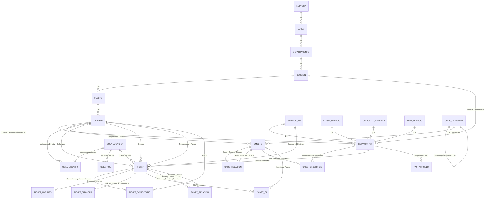

# MODELO.md — Modelo de Datos, Jerarquía CMDB y Mapeo de Fuentes

**Proyecto:** Sistema de Service Desk y Gestión de CMDB con Ingeniería Asistida por IA  
**Asignatura:** Software Avanzado — USAC  
**Estudiante:** Enner (Carné: 202302220)  
**Catedrático Evaluador:** Marco Tulio Aldana Prillwitz (`maldanap-usac`)  
**Fecha:** Octubre de 2026  

---

## 1. Diagrama Entidad-Relación (Mermaid)

---

## 2. Jerarquía y Taxonomía Canónica de la CMDB

Siguiendo las directrices de la Lección 22, Lección 25 e ITIL v4, se modeló una taxonomía jerárquica estricta de 3 niveles con prevención algorítmica de ciclos:

```mermaid
graph TD
    subgraph Nivel1["Nivel 1: Macro-Categorías (Dominios Principales)"]
        CAT_HW["CAT-HW: Hardware e Infraestructura Física"]
        CAT_SW["CAT-SW: Software y Aplicaciones"]
        CAT_NET["CAT-NET: Redes y Telecomunicaciones"]
        CAT_CLOUD["CAT-CLOUD: Nube y Virtualización"]
        CAT_SEC["CAT-SEC: Seguridad y Perímetro"]
        CAT_SRV["CAT-SRV: Servicios de TI"]
    end

    subgraph Nivel2["Nivel 2: Familias de Componentes"]
        CAT_HW --> CAT_HW_SRV["CAT-HW-SRV: Servidores y Cómputo"]
        CAT_HW --> CAT_HW_STR["CAT-HW-STR: Almacenamiento (SAN/NAS)"]
        CAT_HW --> CAT_HW_WRK["CAT-HW-WRK: Terminales y Laptops"]
        CAT_HW --> CAT_HW_DAT["CAT-HW-DAT: Infraestructura Datacenter"]

        CAT_SW --> CAT_SW_SYS["CAT-SW-SYS: Sistemas Operativos Base"]
        CAT_SW --> CAT_SW_DB["CAT-SW-DB: Bases de Datos"]
        CAT_SW --> CAT_SW_MID["CAT-SW-MID: Middleware & Web"]
        CAT_SW --> CAT_SW_APP["CAT-SW-APP: Aplicaciones Empresariales"]

        CAT_NET --> CAT_NET_SW["CAT-NET-SW: Conmutadores (Switches)"]
        CAT_NET --> CAT_NET_RTR["CAT-NET-RTR: Enrutadores (Routers)"]
        CAT_NET --> CAT_NET_WIFI["CAT-NET-WIFI: Puntos de Acceso Wi-Fi"]

        CAT_CLOUD --> CAT_CLOUD_VM["CAT-CLOUD-VM: Máquinas Virtuales"]
        CAT_CLOUD --> CAT_CLOUD_K8S["CAT-CLOUD-K8S: Contenedores y Kubernetes"]
        CAT_CLOUD --> CAT_CLOUD_STO["CAT-CLOUD-STO: Buckets S3 / Blobs"]

        CAT_SEC --> CAT_SEC_FW["CAT-SEC-FW: Firewalls Perimetrales UTM"]
        CAT_SEC --> CAT_SEC_VPN["CAT-SEC-VPN: Gateways VPN"]
        CAT_SEC --> CAT_SEC_CERT["CAT-SEC-CERT: Certificados SSL/TLS"]
    end

    subgraph Nivel3["Nivel 3: Clases / Tipos de CIs Persistidos (5,000 Dispositivos)"]
        CAT_HW_SRV --> CI_SRV_RACK["CI-CLASS-SRV-RACK: Servidor Rack"]
        CAT_HW_SRV --> CI_SRV_BLADE["CI-CLASS-SRV-BLADE: Servidor Blade"]
        CAT_HW_STR --> CI_SAN["CI-CLASS-SAN-ARRAY: Arreglo SAN"]
        CAT_HW_WRK --> CI_LAPTOP["CI-CLASS-LAPTOP: Laptop Corporativa"]
        CAT_HW_DAT --> CI_RACK["CI-CLASS-RACK-42U: Gabinete Pasivo (Sin IP)"]

        CAT_SW_DB --> CI_RDBMS["CI-CLASS-DB-RDBMS: Base Datos MariaDB/PG"]
        CAT_NET_SW --> CI_SW_L3["CI-CLASS-SW-L3: Switch Core Capa 3"]
        CAT_NET_RTR --> CI_RTR["CI-CLASS-RTR-WAN: Router Frontera BGP"]
        CAT_CLOUD_VM --> CI_VM_LINUX["CI-CLASS-VM-LINUX: Instancia Linux"]
        CAT_SEC_FW --> CI_FW["CI-CLASS-FW-NG: Firewall Next-Gen"]
    end
```

---

## 3. Diccionario de Datos Completo

### 3.1 Tabla `cmdb_categorias`
| Campo | Tipo | Clave | Restricción / Descripción |
|---|---|---|---|
| `id` | INT | PK | Identificador numérico secuencial autoincremental |
| `codigo` | VARCHAR(50) | UNIQUE | Código normalizado de la categoría (e.g. `CAT-HW`, `CAT-HW-SRV`) |
| `nombre` | VARCHAR(150) | NOT NULL | Denominación formal del nivel taxonómico |
| `descripcion` | TEXT | NULL | Descripción técnica o alcance del dominio |
| `nivel` | INT | NOT NULL | Nivel en la jerarquía (1: Macro, 2: Familia, 3: Clase) |
| `parent_id` | INT | FK | Relación reflexiva hacia categoría padre (anti-ciclos validado) |
| `activo` | BOOLEAN | DEFAULT 1 | Indicador de disponibilidad operativa |

### 3.2 Tabla `cmdb_cis` (Al menos 5,000 Dispositivos Sintéticos Persistidos)
| Campo | Tipo | Clave | Restricción / Descripción |
|---|---|---|---|
| `id` | INT | PK | Identificador numérico único del CI |
| `codigo` | VARCHAR(100) | UNIQUE | Etiqueta única del dispositivo (e.g. `CI-SRV-RACK-00042`) |
| `nombre` | VARCHAR(200) | NOT NULL | Nombre descriptivo del equipo |
| `categoria_id` | INT | FK | Referencia obligatoria a `cmdb_categorias` |
| `estado` | VARCHAR(50) | DEFAULT 'operativo' | `operativo`, `mantenimiento`, `retirado`, `falla`, `en_almacen` |
| `ubicacion` | VARCHAR(200) | NOT NULL | Datacenter, Rack, Edificio o Región Cloud |
| `responsable_id` | INT | FK | Referencia al usuario asignado como custodio técnico |
| `tiene_ip` | BOOLEAN | DEFAULT 0 | Bandera lógica. No exige IP a dispositivos pasivos/lógicos |
| `ip` | VARCHAR(50) | NULL | Dirección IPv4 asignada si `tiene_ip = true` |
| `mac` | VARCHAR(50) | NULL | Dirección física MAC para dispositivos de red |
| `numero_serie` | VARCHAR(100) | NULL | Número de serie sintético determinista |
| `modelo` | VARCHAR(150) | NULL | Modelo de hardware o versión de software |
| `fabricante` | VARCHAR(150) | NULL | Marca fabricante (Dell, HPE, Cisco, Fortinet, etc.) |
| `atributos_tecnicos` | TEXT | NULL | JSON con especificaciones (CPU, RAM, Ambiente, Generación) |
| `activo` | BOOLEAN | DEFAULT 1 | Baja lógica controlada |

### 3.3 Tabla `cmdb_relaciones` (Grafo Técnico entre CIs)
| Campo | Tipo | Clave | Restricción / Descripción |
|---|---|---|---|
| `id` | INT | PK | Identificador único del enlace |
| `origen_id` | INT | FK | Dispositivo de origen en el grafo (`cmdb_cis.id`) |
| `destino_id` | INT | FK | Dispositivo de destino en el grafo (`cmdb_cis.id`) |
| `tipoRelacion` | VARCHAR(50) | NOT NULL | `depende_de` (DAG acíclico), `conectado_a` (simétrico), `alojado_en` |
| `descripcion` | VARCHAR(255) | NULL | Detalle de la interconexión técnica o protocolo |
| `activo` | BOOLEAN | DEFAULT 1 | Estado del enlace |

### 3.4 Tabla `cmdb_ci_servicios` (Mapeo $N:M$ CI $\leftrightarrow$ Servicio N2)
| Campo | Tipo | Clave | Restricción / Descripción |
|---|---|---|---|
| `id` | INT | PK | Identificador del vínculo |
| `ci_id` | INT | FK | Referencia a `cmdb_cis.id` |
| `servicio_n2_id` | INT | FK | Referencia a `servicio_n2.id` |
| `rolEnServicio` | VARCHAR(100) | NULL | Rol desempeñado (Servidor Core, Backup, Base de Datos Producción) |

### 3.5 Tabla `colas_atencion`
| Campo | Tipo | Clave | Restricción / Descripción |
|---|---|---|---|
| `id` | INT | PK | Identificador de la cola |
| `codigo` | VARCHAR(50) | UNIQUE | Código mnemotécnico de la cola (e.g. `COLA-INC-L1`, `COLA-CAMBIOS`) |
| `nombre` | VARCHAR(150) | NOT NULL | Denominación formal |
| `proceso` | VARCHAR(50) | NOT NULL | Exactamente 1 de los 7 procesos ITIL |
| `nivelSoporte` | INT | DEFAULT 1 | Nivel 0 a 4 (0: Autoservicio, 1: HelpDesk, 2: Soporte, 3: Ing, 4: Ext) |
| `sla_minutos_primera_atencion` | INT | DEFAULT 60 | Objetivo de tiempo para primera respuesta |
| `sla_minutos_resolucion` | INT | DEFAULT 480 | Objetivo de tiempo para resolución total |
| `tipo_tiempo` | VARCHAR(20) | DEFAULT 'habil' | `calendario` (24/7) o `habil` (jornada laboral) |
| `regla_ordenamiento` | VARCHAR(50) | DEFAULT 'prioridad_antiguedad' | Criterio determinista de ordenamiento en cola |
| `politica_asignacion` | VARCHAR(50) | DEFAULT 'manual' | `manual`, `automatica` o `mixta` |
| `activo` | BOOLEAN | DEFAULT 1 | Desactivación restrictiva (requiere cola de reasignación si hay tickets) |

### 3.6 Tabla `tickets`
| Campo | Tipo | Clave | Restricción / Descripción |
|---|---|---|---|
| `id` | INT | PK | Identificador autoincremental |
| `numero` | VARCHAR(50) | UNIQUE | Correlativo único de radicación (`TK-2026-XXXXX`) |
| `titulo` | VARCHAR(200) | NOT NULL | Asunto o resumen de la solicitud |
| `descripcion` | TEXT | NOT NULL | Detalle exhaustivo del requerimiento |
| `solicitante_id` | INT | FK | Usuario que solicita el trámite |
| `creador_id` | INT | FK | Usuario o sistema que registró el ticket |
| `servicio_n2_id` | INT | FK | Servicio del catálogo involucrado |
| `servicio_n1_id` | INT | FK | Nivel 1 derivado obligatoriamente del Nivel 2 |
| `tipo` | VARCHAR(50) | NOT NULL | 6 tipos de diapositiva 14 (`solicitud_acceso`, `evento`, `incidente`, `solicitud_cambio`, `requisicion_servicio`, `problema`) |
| `proceso` | VARCHAR(50) | NOT NULL | 1 de los 7 procesos ITIL obligatorios |
| `cola_id` | INT | FK | Cola de atención asignada |
| `responsable_id` | INT | FK (NULL) | Agente asignado mediante concurrencia atómica |
| `estado` | VARCHAR(50) | DEFAULT 'nuevo' | `nuevo`, `asignado`, `en_progreso`, `en_espera`, `aprobado`, `rechazado`, `resuelto`, `cerrado` |
| `prioridad` | VARCHAR(20) | DEFAULT 'media' | `muy_alta`, `alta`, `media`, `baja`, `muy_baja` |
| `impacto` | VARCHAR(20) | DEFAULT 'medio' | `alto`, `medio`, `bajo` |
| `urgencia` | VARCHAR(20) | DEFAULT 'media' | `alta`, `media`, `baja` |
| `canal` | VARCHAR(50) | DEFAULT 'portal' | `portal`, `correo`, `telefono`, `monitoreo`, `chat` |
| `sin_ci_justificacion` | TEXT | NULL | Registro explícito cuando el trámite no involucra CI |
| `metadata_proceso` | TEXT | NULL | JSON con datos específicos (E0-E3, I0-I6, planes RFC, etc.) |
| `fecha_creacion` | DATETIME | NOT NULL | Timestamp de registro en servidor |
| `fecha_primera_respuesta` | DATETIME | NULL | Timestamp del primer contacto con el solicitante |
| `fecha_resolucion` | DATETIME | NULL | Timestamp de pase a estado `resuelto` |
| `fecha_cierre` | DATETIME | NULL | Timestamp de pase a estado `cerrado` |
| `fecha_reapertura` | DATETIME | NULL | Timestamp si fue reabierto |
| `solucion_aplicada` | TEXT | NULL | Obligatoria para permitir resolución o cierre (P15) |

---

## 4. Mapeo de Fuentes entre Documentos y la Implementación

| Concepto / Atributo | Fuente Original | Implementación en Sistema | Diferencias y Justificación de Ingeniería |
|---|---|---|---|
| **Catálogo Nivel 1** | `CatalogoServicios.xlsx` (Hoja Servicios Externos, Col A-B) | Entidad `ServicioN1` (12 registros exactos) | Se mantuvo la cota de 12 registros y el nombre canónico oficial `"Suministrar Analítica"` para `SE.12`. |
| **Catálogo Nivel 2** | `CatalogoServicios.xlsx` (Col C-L) | Entidad `ServicioN2` (46 registros exactos) | Se preservaron datos nulos como `NULL` sin convertir a ceros ni inventar clasificaciones. |
| **Tipos de Ticket** | Presentación Service Desk, Diapositiva 14 | Columna `tickets.tipo` | 6 tipos exactos: `solicitud_acceso`, `evento`, `incidente`, `solicitud_cambio`, `requisicion_servicio`, `problema`. |
| **Categorías de Eventos** | Presentación Service Desk, Diapositiva 15 | Campo JSON `metadataProceso.categoriaEvento` | E0 (programado), E1 (sin impacto), E2 (con impacto/incidente), E3 (seguridad/incidente). E2 y E3 disparan incidente automático. |
| **Categorías de Incidentes** | Presentación Service Desk, Diapositiva 16 | Campo JSON `metadataProceso.categoriaIncidente` | I0 (sin interrupción), I1 ($\le 3$h), I2 ($\le 8$h), I3 ($\le 2$d), I4 ($\le 1$sem), I5 ($\ge 1$mes), I6 (seguridad de la información). |
| **Jerarquía CMDB** | Lección 22 y `CMDB.xlsx` | `CmdbCategoria` y `CmdbCi` | Macro-categorías (Nivel 1), Familias (Nivel 2) y Clases de CIs (Nivel 3). Validación de anti-ciclos con recorrido DFS. |
| **Dirección IP** | Enunciado Sección 8 | Columna `tiene_ip`, `ip` | Dispositivos pasivos/lógicos no reciben IP obligatoria para evitar artefactos sintéticos ficticios. |
| **Niveles de Soporte** | Diapositivas 11 y 12-13 | `cola_atencion.nivelSoporte` | Mapeo unificado L0 (Autoservicio) a L4 (Externo/Proveedores), documentando la equivalencia de proveedores en L3/L4. |
