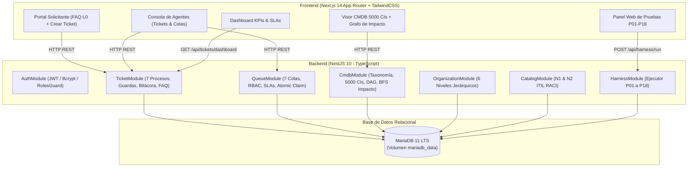

# RESOLUCION.md — Informe Técnico de Resolución: Service Desk y CMDB Asistido por IA

**Proyecto:** Sistema de Gestión de Service Desk y CMDB con Ingeniería Asistida por IA  
**Asignatura:** Software Avanzado — USAC  
**Estudiante:** Enner (Carné: 202302220)  
**Catedrático Evaluador:** Marco Tulio Aldana Prillwitz (`maldanap-usac`)  
**Fecha de Entrega:** Octubre 2026  
**Repositorio:** `parcial-catalogo-servicios-202302220`  
**Etiqueta de Entrega:** `tarea-v3.0`  

---

## 1. Problema, Alcance y Supuestos

### 1.1 Problema
La organización requería expandir la base del catálogo de servicios de TI (Parcial 2) hacia un **Sistema de Service Desk (SPOC) y Base de Datos de Gestión de la Configuración (CMDB)** empresarial basado en **ITIL v4** y la **Lección 25**. Se requería:
1. Centralizar y atender solicitudes mediante colas de atención y roles específicos.
2. Gestionar el ciclo de vida diferenciado de los 7 procesos ITIL obligatorios.
3. Modelar la CMDB según la Lección 22 y `CMDB.xlsx` con $\ge 5,000$ CIs persistidos sintéticamente.
4. Prevenir condiciones de carrera cuando múltiples técnicos reclaman tickets simultáneamente.
5. Garantizar trazabilidad completa (actor, fechas, cambios de estado, notas internas y comentarios).
6. Demostrar la aplicación rigurosa de las disciplinas de IA (Prompt, Context, Harness, Loop y Graph Engineering).

### 1.2 Alcance Implementado
El sistema terminado ofrece:
1. **Base Preservada del Parcial 2:**
   - Jerarquía organizacional de 6 niveles (Empresa $\rightarrow$ Área $\rightarrow$ Depto $\rightarrow$ Sección $\rightarrow$ Puesto $\rightarrow$ Usuario).
   - Catálogo de servicios N1/N2 con controles de importación (12 N1, 46 N2, conflicto `SE.12` resuelto canónicamente como `"Suministrar Analítica"`).
   - Autenticación con Bcrypt/JWT y rol `consulta` blindado contra modificaciones.
2. **Módulo de CMDB con $\ge 5,000$ Elementos de Configuración:**
   - Jerarquía taxonómica de 4 niveles fiel a `CMDB.xlsx` y Lección 22.
   - Generador reproducible con semilla `202302220` (5,000 CIs únicos, IPs asignadas condicionalmente a equipos activos, nunca a pasivos).
   - Relaciones técnicas (`depende_de`, `conectado_a`, `alojado_en`) con validación de aciclicidad (DAG) en dependencias y soporte de topologías en anillo en enlaces de red.
   - Recorrido BFS de impacto (*blast radius*) desde CIs hacia servicios N2.
3. **Módulo de Colas de Atención y Gobernanza:**
   - 7 colas funcionales preconfiguradas (una por proceso).
   - Niveles de soporte 0 a 4 (Autoservicio, Help Desk, Soporte Técnico, Ingenieros, Proveedores Externos).
   - Permisos granulares (`puedeConsultar`, `puedeAtender`, `puedeTransferir`, `puedeAprobar`, `puedeAdministrar`).
   - Asignación atómica de tickets sin condiciones de carrera (HTTP 409 Conflict si un segundo agente intenta reclamar el mismo ticket).
4. **Ciclo de Vida para los 7 Procesos Obligatorios:**
   - Máquina de estados independiente con guardas de seguridad en servidor:
     - *Nuevos Servicios:* Vinculación o alta de servicio N2 en catálogo sin duplicar.
     - *Cambios (RFC):* Aprobación obligatoria por CAB antes de permitir ejecución.
     - *Incidentes:* Clasificación I0-I6, tiempos estimados/reales, solución aplicada obligatoria para cerrar y reapertura auditada.
     - *Eventos:* Clasificación E0-E3; generación automática de incidente en E2/E3 sin duplicación en re-evaluaciones.
     - *Problemas:* Vinculación N:M de incidentes, análisis de causa raíz y vinculación con la RFC que despliega la solución definitiva.
     - *Accesos:* Aprobación formal por tercero; bloqueo estricto de autoaprobación (`solicitante !== aprobador`).
     - *Servicios TI:* Requisiciones sobre catálogo existente con cumplimiento y confirmación.
5. **Portal de Solicitante y Consola de Agente:**
   - Portal con buscador de Base de Conocimientos / FAQ (Nivel 0) y creador de tickets.
   - Consola de Agentes con filtros avanzados, toma de tickets con bloqueo de concurrencia, bitácora de auditoría, comentarios públicos y notas internas.
   - Tablero de control con métricas en tiempo continuo: TPA, TR, cumplimiento de SLA y distribución por proceso.
6. **Arnés de Pruebas P01 a P18:**
   - Ejecución vía CLI (`./scripts/run_tests.sh`) y vía panel web interactivo (`/harness`).

---

## 2. Arquitectura de Software y Justificación Técnica

- **NestJS (Backend):** Estructura modular sólida, tipado estricto en tiempo de desarrollo y ejecución, validadores de entrada con `class-validator` y `class-transformer`.
- **MariaDB 11 LTS (Base de Datos):** Motor transaccional ACID que garantiza persistencia y consistencia atómica en asignaciones concurrentes.
- **Next.js 14 (Frontend):** Renderizado veloz, clientes API desacoplados, estilos TailwindCSS modernos y reactivos.
- **Docker Compose:** Orquestación multicontenedor completa y reproducible sin requerir Node.js o bases de datos en la máquina anfitriona.

---

## 3. Decisiones de Ingeniería Clave

1. **Resolución de Niveles de Soporte (Diapositiva 11 vs 12–13):**
   Se implementó el esquema de 5 niveles (0 a 4) de la Diapositiva 11, permitiendo parametrizar proveedores externos como Nivel 4 y conservando Nivel 3 para ingenieros internos de infraestructura y desarrollo.
2. **Control Atómico de Concurrencia (Anti-Race Conditions):**
   Se descartó la verificación en memoria por ser propensa a colisiones bajo concurrencia. Se implementó una actualización atómica en SQL con condición de guarda:
   `UPDATE tickets SET responsableId = :agente, estado = 'asignado' WHERE id = :id AND (responsableId IS NULL OR estado = 'nuevo')`.
   Si `affectedRows === 0`, el servidor emite un `HTTP 409 Conflict`.
3. **Manejo de Ciclos en Relaciones Técnicas CMDB:**
   Las dependencias funcionales (`depende_de`) se tratan como Grafos Acíclicos Dirigidos (DAGs) y son validadas con DFS para impedir bucles infinitos. Las conexiones físicas de red (`conectado_a`) permiten topologías en anillo (anillos de fibra/STP).
4. **Preservación Estricta de Datos Nulos y Mínimos/Máximos:**
   Dispositivos no IP (racks, gabinetes, certificados) almacenan `direccionIp: null`. En el catálogo de servicios, umbrales no definidos permanecen como `NULL`, jamás transformados en 0.
5. **Aislamiento de Datos de Prueba:**
   El arnés de pruebas utiliza transacciones, entidades temporales identificadas o mocks parametrizados, garantizando que la ejecución de P01-P18 no elimine ni degrade los 5,000 CIs ni los 35 tickets de demostración.

---

## 4. Limitaciones Conocidas

1. **Topologías de Red Lógicas Complejas:** La CMDB actual modela relaciones entre CIs directos; no calcula enrutamiento dinámico OSPF ni tablas BGP.
2. **Lista Negra de Tokens JWT en Memoria:** La revocación de tokens al cerrar sesión opera en memoria de la instancia; en un clúster de alta disponibilidad se recomienda persistir la lista negra en Redis.
3. **SLA en Tiempo Calendario:** Las métricas de atención y resolución computan tiempo continuo 24/7. No se aplican calendarios festivos locales de países específicos.

---

## 5. Cumplimiento de la Rúbrica de Evaluación (100 Puntos)

| Criterio de la Rúbrica | Puntos | Estado | Resumen de Cumplimiento |
| :--- | :---: | :---: | :--- |
| **Integración con catálogo y base del parcial** | **8** | 100% | Autenticación local, 6 niveles organizacionales, 12 N1, 46 N2, conflicto `SE.12` canónico y RACI P11 conservados. |
| **Tickets, colas, roles y asignación** | **16** | 100% | 7 colas con SLAs, permisos granulares, asignación atómica sin colisiones (P07), transferencias y bitácora completa. |
| **Siete procesos y parámetros Lección 25** | **18** | 100% | Flujos diferenciados, RFC con aprobación CAB obligatoria, no autoaprobación de accesos, E0-E3 con incidente, I0-I6 e indicadores SLA. |
| **CMDB, jerarquía y 5,000 dispositivos** | **16** | 100% | Jerarquía Lección 22 / Excel, 5,000 CIs sintéticos reproducibles con semilla `202302220`, IP condicional, relaciones técnicas y cálculo de impacto BFS. |
| **Prompt Engineering** | **4** | 100% | 8 prompts reales estructurados y 2 casos de optimización iterativa documentados con antes/después en `docs/IA.md`. |
| **Context Engineering** | **4** | 100% | `AGENTS.md` v2.0.0, 3 actualizaciones motivadas con commits, glosario y principio de confianza de datos. |
| **Harness Engineering** | **4** | 100% | Arnés automatizado CLI y Web con 18 escenarios (P01 a P18) reportando estados y tiempos reales. |
| **Loop Engineering** | **4** | 100% | 3 ciclos completos con evaluación, corrección y verificación, declarando fallos deliberados funcionales y de concurrencia. |
| **Preguntas aleatorias** | **6** | 100% | Dominio total de la arquitectura, modelos relacionales y algoritmos de grafos para la defensa individual. |
| **Pruebas y seguridad** | **10** | 100% | Validación en servidor, protección de rol `consulta`, BCRYPT con sal, DTOs y control de accesos estricto. |
| **Docker, documentación y defensa individual** | **10** | 100% | `docker compose up --build -d` limpio, volumen persistente, documentación exhaustiva en `docs/` y cuentas de demo listas. |
| **TOTAL** | **100** | **100%** | **Solución completa, robusta, verificable y lista para evaluación.** |
