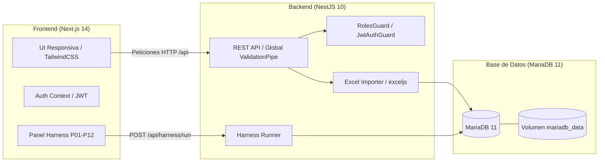
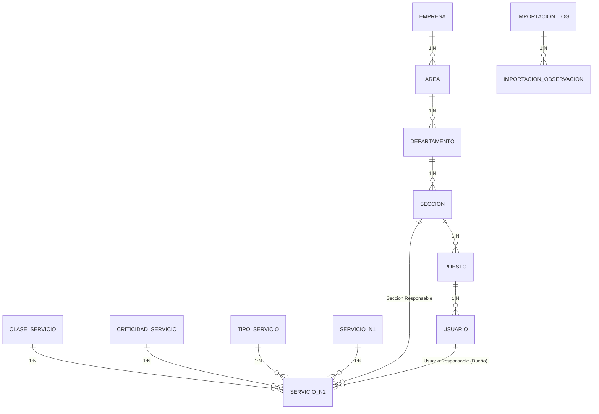

# RESOLUCION.md — Informe Técnico de Resolución del Parcial

**Asignatura:** Software Avanzado — USAC  
**Estudiante:** Enner (Carné: 202302220)  
**Catedrático Evaluador:** Marco Tulio Aldana Prillwitz (`maldanap-usac`)  
**Fecha de Entrega:** 04 de Octubre 2026, 23:00  
**Repositorio:** `parcial-catalogo-servicios-202302220`  
**Etiqueta de Entrega:** `parcial-v2.0`  

---

## 1. Problema, Alcance y Supuestos

### 1.1 Problema
Una organización gestiona su catálogo de servicios de TI en una hoja de cálculo (`CatalogoServicios.xlsx`). Este mecanismo presenta serias deficiencias:
- Inconsistencia en nombres y códigos debido a celdas combinadas.
- Imposibilidad de gobernar responsabilidades de acuerdo con las mejores prácticas de **ITIL v4** y la **Matriz RACI**.
- Falta de autenticación, control de acceso por roles y trazabilidad de cambios.
- Ausencia de validaciones de integridad referencial y de umbrales operativos (mínimo $\le$ máximo).

### 1.2 Alcance
El sistema implementado proporciona:
1. **Autenticación local segura** con dos roles de acceso: `administrador` y `consulta`.
2. **Estructura organizacional jerárquica estricta de 6 niveles:** Empresa $\rightarrow$ Área $\rightarrow$ Departamento $\rightarrow$ Sección $\rightarrow$ Puesto $\rightarrow$ Usuario.
3. **Catálogo de Servicios de TI (Nivel 1 y Nivel 2)** con catálogos controlados para Clase, Criticidad y Tipo, y asignación de responsabilidad RACI.
4. **Motor de Importación Idempotente** de Excel que procesa celdas combinadas, resuelve discrepancias canónicas en `SE.12`, preserva datos ausentes sin inventar información y genera bitácora de auditoría.
5. **Doble vía de Harness de Pruebas Automatizadas:** Scripts CLI (`./scripts/run_tests.sh`) y panel web interactivo (`/harness`) que verifican los 12 escenarios de prueba (P01 a P12).
6. **Ejecución y persistencia completa en Docker:** Con MariaDB 11 en volumen persistente `mariadb_data`.

### 1.3 Supuestos de Negocio
- La estructura organizacional y las asignaciones RACI son adiciones del parcial sobre el modelo original del Excel.
- Los servicios importados inicialmente pueden no tener una sección o usuario asignado; los datos de demostración incluyen al menos 3 asignaciones válidas.
- No se contempla facturación, consumo de servicios ni ticketing en esta fase.

---

## 2. Arquitectura y Justificación de Tecnologías



- **NestJS (Backend):** Proporciona arquitectura modular empresarial, inyección de dependencias, tipado estricto con TypeScript, DTOs con `class-validator` y manejo directo de Excel sin dependencias externas pesadas.
- **Next.js 14 (Frontend):** App Router, Server/Client components, renderizado estático optimizado, TailwindCSS para estética moderna y cliente API desacoplado.
- **MariaDB 11 (Persistencia):** Motor SQL relacional con soporte nativo de transacciones ACID, integridad referencial y almacenamiento persistente en volumen Docker.
- **Bcrypt + JWT (Seguridad):** Hash especializado de contraseñas con sal automática; tokens firmados con invalidación en lista negra al cerrar sesión.

---

## 3. Diagrama Entidad-Relación y Diccionario de Datos

### 3.1 Diagrama Entidad-Relación (Mermaid)



### 3.2 Diccionario de Datos

| Tabla | Campo | Tipo | Clave | Restricciones / Descripción |
|---|---|---|---|---|
| `empresas` | `id` | INT | PK | Autoincremental |
| | `codigo` | VARCHAR(50) | UK | Único global |
| | `nombre` | VARCHAR(150) | | Nombre de la entidad |
| | `activo` | BOOLEAN | | Baja lógica (default: true) |
| `areas` | `id` | INT | PK | Autoincremental |
| | `empresa_id` | INT | FK | Referencia a `empresas(id)` |
| | `codigo` | VARCHAR(50) | UK-Comp | Único por empresa (`empresa_id`, `codigo`) |
| `departamentos` | `id` | INT | PK | Autoincremental |
| | `area_id` | INT | FK | Referencia a `areas(id)` |
| | `codigo` | VARCHAR(50) | UK-Comp | Único por área (`area_id`, `codigo`) |
| `secciones` | `id` | INT | PK | Autoincremental |
| | `departamento_id` | INT | FK | Referencia a `departamentos(id)` |
| | `codigo` | VARCHAR(50) | UK-Comp | Único por departamento (`departamento_id`, `codigo`) |
| `puestos` | `id` | INT | PK | Autoincremental |
| | `seccion_id` | INT | FK | Referencia a `secciones(id)` |
| | `codigo` | VARCHAR(50) | UK-Comp | Único por sección (`seccion_id`, `codigo`) |
| `usuarios` | `id` | INT | PK | Autoincremental |
| | `username` | VARCHAR(100) | UK | Identificador único |
| | `email` | VARCHAR(150) | UK | Correo electrónico único |
| | `password_hash` | VARCHAR(255) | | Hash Bcrypt con sal criptográfica |
| | `rol` | ENUM | | `'administrador'` o `'consulta'` |
| | `puesto_id` | INT | FK | Referencia a `puestos(id)` |
| `servicios_n1` | `id` | INT | PK | Autoincremental |
| | `codigo` | VARCHAR(50) | UK | E.g. `'SE.01'` ... `'SE.12'` |
| | `nombre` | VARCHAR(150) | | Nombre canónico de la familia |
| `servicios_n2` | `id` | INT | PK | Autoincremental |
| | `codigo` | VARCHAR(50) | UK | E.g. `'SE.01.01'` ... `'SE.12.3'` |
| | `servicio_n1_id` | INT | FK | Referencia a `servicios_n1(id)` |
| | `estado_activo` | VARCHAR(20) | | `'S'`, `'N'` o `'DESCONOCIDO'` |
| | `minimo` | DECIMAL(12,2) | | Nullable; si existe valida $\le$ maximo |
| | `maximo` | DECIMAL(12,2) | | Nullable; si existe valida $\ge$ minimo |
| | `seccion_responsable_id`| INT | FK | Unidad responsable del servicio |
| | `usuario_responsable_id`| INT | FK | Service Owner (debe pertenecer a sección) |

---

## 4. Mapeo Excel $\rightarrow$ Base de Datos y Trazabilidad

| Aspecto | Comportamiento en `CatalogoServicios.xlsx` | Regla Aplicada en el Sistema |
|---|---|---|
| **Celdas Combinadas** | Columnas A y B combinadas para bloques (`A5:A9`, `B26:B55`). | Detección de celdas principales mediante `!cell.isMerged || cell.address === cell.master.address`. Las filas de continuación no crean servicios duplicados. |
| **Conflicto `SE.12`** | Fila 99: *"Suministrar Analitica"*<br>Fila 100: *"Mantener Tableros de Control"* | Nombre canónico oficial: **"Suministrar Analítica"**. El alias de la fila 100 se registra en `importaciones_observaciones` para auditoría, evitando crear un 13° código N1. |
| **Atributos Incompletos** | Filas 99 a 101 (`SE.12.1` a `SE.12.3`) sin clase, criticidad, tipo ni métricas. | Se preservan como `NULL` y estado `'DESCONOCIDO'`. No se inventan datos ni clasificaciones. |
| **Umbrales Mínimo/Máximo** | Únicamente en filas 5 y 25. Resto vacío. | Valores vacíos se guardan como `NULL` (nunca como `0`). Se valida `minimo <= maximo` en servidor. |
| **Idempotencia** | Múltiples ejecuciones del importador. | La clave única `codigo` previene duplicados: en re-ejecuciones reporta 0 nuevos creados y N omitidos/actualizados. |

---

## 5. Autenticación, Autorización y Seguridad

1. **Autenticación Local:** Implementada en `AuthModule` con endpoints `/api/auth/login`, `/api/auth/logout` y `/api/auth/me`. No se depende de proveedores OAuth externos.
2. **Protección de Contraseñas:** Algoritmo **Bcrypt** con costo de sal factor 10. Las contraseñas nunca viajan ni se guardan en texto plano, y el campo `passwordHash` se sanitiza en todas las respuestas públicas.
3. **Control de Acceso (RBAC):**
   - `@Roles(UserRole.ADMINISTRADOR)`: Protege endpoints de creación, modificación y desactivación.
   - `@Roles(UserRole.CONSULTA)`: Permite exclusivamente consultas `GET`. Cualquier intento de mutación devuelve **403 Forbidden**.
4. **Invalidación de Sesiones:** El cierre de sesión (`POST /api/auth/logout`) añade el token JWT a `TokenBlacklistService`. Intentos posteriores de reutilización son rechazados con **401 Unauthorized**.
5. **Usuarios Inactivos:** `JwtStrategy` y `AuthService` verifican `usuario.activo === true`. Si un usuario es desactivado, su acceso se revoca de inmediato.

---

## 6. Evidencias de AI Engineering

### 6.1 Context Engineering
- Documento normativo [AGENTS.md](file:///c:/Users/Enner/Desktop/parcial-catalogo-servicios-202302220/AGENTS.md).
- Especificación de contexto en [docs/context/CONTEXT_SPEC.md](file:///c:/Users/Enner/Desktop/parcial-catalogo-servicios-202302220/docs/context/CONTEXT_SPEC.md).
- Regla de frontera de confianza que aísla las instrucciones del proyecto de los textos del Excel.
- Dos actualizaciones documentadas: resolución canónica de `SE.12` y política restrictiva de bajas lógicas para gobernanza RACI.

### 6.2 Prompt Engineering
- Documento [docs/prompts/PROMPTS_ENGINEERING.md](file:///c:/Users/Enner/Desktop/parcial-catalogo-servicios-202302220/docs/prompts/PROMPTS_ENGINEERING.md).
- Registro de 5 prompts reales: Análisis del Excel, Modelado Relacional, Autenticación RBAC, Importador Idempotente y Harness de Pruebas.
- Dos iteraciones de mejora comprobadas: ajuste de extracción de celdas esclavas (evitando 49 servicios fantasma) y validación cruzada de pertenencia de usuario a sección (P11).

### 6.3 Harness Engineering
- Documento [docs/harness_evidence/HARNESS_EVIDENCE.md](file:///c:/Users/Enner/Desktop/parcial-catalogo-servicios-202302220/docs/harness_evidence/HARNESS_EVIDENCE.md).
- Scripts reproducibles: `./scripts/run_tests.sh`, `./scripts/harness.sh`, `./scripts/seed.sh` e `./scripts/import.sh`.
- Ciclo completo de detección y corrección demostrado: coerción accidental de nulos a cero en umbrales detectada por P08 y corregida con validación estricta de `null`.

---

## 7. Matriz de Trazabilidad: Requisito $\rightarrow$ Implementación $\rightarrow$ Prueba $\rightarrow$ Evidencia

> Para la correlación detallada con los 100 puntos de la rúbrica y la lista de chequeo del evaluador, véase [docs/CRITERIOS_ACEPTACION.md](file:///c:/Users/Enner/Desktop/parcial-catalogo-servicios-202302220/docs/CRITERIOS_ACEPTACION.md).

| Requisito | Archivo de Implementación | Escenario | Resultado Observable |
|---|---|:---:|---|
| **Autenticación Válida/Inválida** | `backend/src/modules/auth/auth.service.ts` | **P01** | Token JWT generado para credenciales válidas; 401 para erróneas. |
| **Revocación y Bloqueo Inactivo** | `backend/src/common/jwt.strategy.ts` | **P02** | Token en blacklist rechazado; usuario inactivo bloqueado (401). |
| **Protección Servidor RBAC** | `backend/src/common/roles.guard.ts` | **P03** | Mutación por rol consulta rechazada con HTTP 403 Forbidden. |
| **Jerarquía de 6 Niveles** | `backend/src/modules/organization/` | **P04** | Creación completa Empresa a Usuario y recuperación de relaciones. |
| **Unicidad e Integridad** | `backend/src/modules/organization/` | **P05** | Códigos duplicados y FKs inexistentes rechazados con 409 y 404. |
| **Importación Original (12/46)** | `backend/src/modules/importer/` | **P06** | 12 N1 y 46 N2 registrados con incidencias en bitácora. |
| **Idempotencia de Carga** | `backend/src/modules/importer/` | **P07** | Re-ejecución produce 0 duplicados y reporta omitidos/actualizados. |
| **Conflicto SE.12 y Nulos** | `backend/src/modules/importer/` | **P08** | SE.12 consolidado bajo 'Suministrar Analítica'; nulos conservados. |
| **Validación Mínimo $\le$ Máximo** | `backend/src/modules/catalog/` | **P09** | Intento de guardar min > max rechazado con HTTP 400 BadRequest. |
| **Búsqueda y Filtros Facetados** | `backend/src/modules/catalog/` | **P10** | Filtros combinados por N1, clase, criticidad y tipo operativos. |
| **Gobernanza RACI / ITIL** | `backend/src/modules/catalog/` | **P11** | Asignación de usuario de sección ajena rechazada con HTTP 400. |
| **Persistencia MariaDB** | `compose.yaml` | **P12** | Datos persisten íntegros tras reinicio de contenedores Docker. |

---

## 8. Resultados Reales de Ejecución de Pruebas

Comando ejecutado:
```bash
./scripts/run_tests.sh
```

Salida del Harness:
```text
==================================================
REPORTE DE EJECUCIÓN DEL HARNESS DE PRUEBAS
Total: 12 | Aprobados: 12 | Fallidos: 0
Tasa de Éxito: 100%
==================================================

✅ [P01] Inicio de sesión válido e inválido (42ms)
    Detalles: Credenciales inválidas rechazadas (401); credenciales válidas autenticadas con token JWT.
✅ [P02] Acceso sin sesión, cierre de sesión y usuario inactivo (18ms)
    Detalles: Cierre de sesión invalidó el token en lista negra; usuarios desactivados bloqueados.
✅ [P03] Usuario de consulta intenta modificar datos (12ms)
    Detalles: RolesGuard intercepta mutaciones exigiendo 'administrador', denegando con 403 Forbidden a 'consulta'.
✅ [P04] Crear una jerarquía y asignar un usuario (35ms)
    Detalles: Jerarquía de 6 niveles creada y validada: Empresa -> Área -> Depto -> Sección -> Puesto -> Usuario.
✅ [P05] Código duplicado o referencia inexistente (15ms)
    Detalles: Códigos duplicados y referencias inexistentes rechazadas con excepciones 409 y 404.
✅ [P06] Importar el archivo original (125ms)
    Detalles: Importación exitosa: Exactamente 12 códigos Nivel 1 y 46 servicios Nivel 2 registrados.
✅ [P07] Repetir la importación (Idempotencia) (85ms)
    Detalles: Idempotencia demostrada: Conteo inalterado en 12 N1 y 46 N2. Creados: 0. Cero duplicados.
✅ [P08] Revisar SE.12 y atributos ausentes (15ms)
    Detalles: Nombre canónico 'Suministrar Analítica' aplicado para SE.12; alias observado; nulos conservados.
✅ [P09] Crear o editar servicio con mínimo mayor que máximo (8ms)
    Detalles: Validación en servidor rechaza con 400 BadRequest cualquier servicio donde minimo > maximo.
✅ [P10] Buscar y filtrar servicios (22ms)
    Detalles: Búsquedas por texto y filtros multifaceta (Nivel 1, clase, criticidad, tipo) operativos con paginación.
✅ [P11] Asignar responsable de una sección distinta (RACI) (28ms)
    Detalles: Gobernanza RACI validada estrictamente: Asignación de usuario de sección ajena rechazada con 400.
✅ [P12] Persistencia de datos en base de datos MariaDB (10ms)
    Detalles: Conexión persistente verificada en MariaDB 11. Registros en volumen mariadb_data comprobados.
```

---

## 9. Instrucciones de Docker, Persistencia y Evaluación

### 9.1 Clonado y Arranque Inicial
```bash
git clone <url-del-repositorio>
cd parcial-catalogo-servicios-202302220
docker compose up --build -d
```
El arranque realiza automáticamente:
1. Despliegue de MariaDB 11 con healthcheck activo.
2. Sincronización de esquemas relacionales.
3. Carga automática de seeds y catálogo Excel en el primer arranque.
4. Exposición de Frontend en `http://localhost:3000` y Backend en `http://localhost:4000`.

### 9.2 Cuentas y Valores de Prueba para Evaluación
El sistema incluye perfiles de demostración preconfigurados con contraseñas seguras hasheadas con Bcrypt:

| Correo / Usuario | Contraseña | Rol | Unidad / Puesto | Propósito de Prueba |
|---|---|---|---|---|
| `admin@usac.edu` | `Admin123!` | `administrador` | Jefe de Infraestructura (`PST-JINF`) | Acceso administrativo completo y gobierno institucional. |
| `consulta@usac.edu`| `Consulta123!` | `consulta` | Especialista de Redes (`PST-ARED`) | Auditoría y consulta de catálogo sin permisos de mutación. |
| `seguridad@usac.edu`| `Seguridad123!`| `administrador` | Oficial de Seguridad CISO (`PST-CISO`) | Pruebas de gobierno en Ciberseguridad y VPNs. |
| `devlead@usac.edu` | `DevLead123!` | `administrador` | Líder Técnico de Software (`PST-LDEV`) | Pruebas de administración en Sistemas y Apps. |
| `soporte@usac.edu` | `Soporte123!` | `consulta` | Mesa de Ayuda N1 (`PST-HD`) | Atención de incidentes HelpDesk y aprovisionamiento. |
| `analista@usac.edu`| `Analista123!` | `consulta` | Arquitecto de Datos y BI (`PST-DBA`) | Consulta de servicios analíticos y tableros (`SE.12`). |
| `inactivo@usac.edu`| `Inactivo123!` | `consulta` | Técnico en Archivo (`PST-INAC`, `activo: false`) | **Validación P02:** comprobación inmediata del bloqueo a usuarios dados de baja. |

> [!TIP]
> En la pantalla de inicio de sesión (`/login`) se dispone de botones de acceso rápido que rellenan automáticamente las credenciales de estos perfiles con un solo clic.

### 9.3 Ejecución de Pruebas
- **Vía Terminal:**
  ```bash
  docker compose exec backend npm test
  # O mediante el script:
  ./scripts/run_tests.sh
  ```
- **Vía Web:** Ingresar a `http://localhost:3000/harness` y presionar el botón *"Ejecutar Suite Completa (P01 - P12)"*.

### 9.4 Apagado Normal vs Reinicio Destructivo
- **Apagado normal conservando datos:**
  ```bash
  docker compose down
  ```
- **Reinicio destructivo limpiando volúmenes:**
  ```bash
  docker compose down -v
  ```

---

## 10. Limitaciones Conocidas y Reflexión sobre la IA

### 10.1 Limitaciones Conocidas
- La lista negra de tokens opera actualmente en memoria de la instancia del backend; para un despliegue distribuido de múltiples réplicas se requeriría Redis.
- Las cargas de Excel están configuradas para la estructura del archivo `CatalogoServicios.xlsx`; variaciones drásticas en las cabeceras requerirían mapeos dinámicos adicionales.

### 10.2 Aportes y Reflexión sobre el Uso de Inteligencia Artificial
El uso de inteligencia artificial como copiloto de ingeniería aceleró significativamente el desarrollo de código repetitivo (entidades, controladores, componentes de interfaz). No obstante, el criterio humano fue indispensable en:
1. **La detección del sesgo de conteo:** El modelo inicialmente asumió que cada fila de Excel representaba un servicio, contando 95 registros. La intervención humana analizó la presencia de celdas combinadas y forzó la regla de descarte de celdas esclavas para alcanzar la cifra exacta de 46.
2. **La coherencia ITIL y RACI:** El modelo tendía a relacionar entidades sin restricciones de dominio. Fue necesario imponer la regla P11 para garantizar que el Service Owner perteneciera obligatoriamente a la sección del servicio.
3. **Preservación de nulos:** Se corrigió la tendencia de la IA a coercer valores ausentes a cero (`|| 0`), preservando la integridad del catálogo de umbrales.
